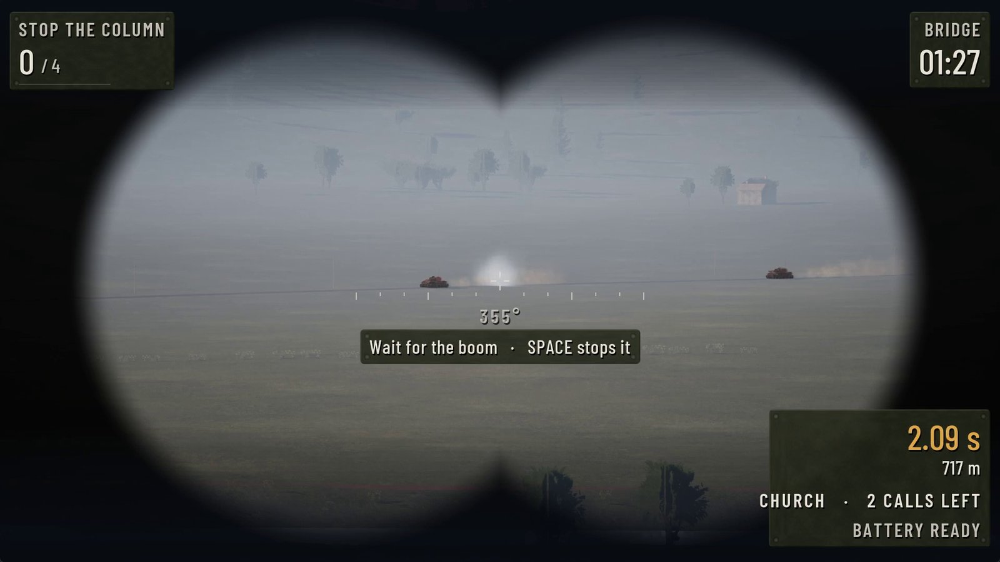
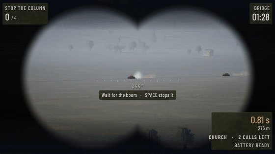
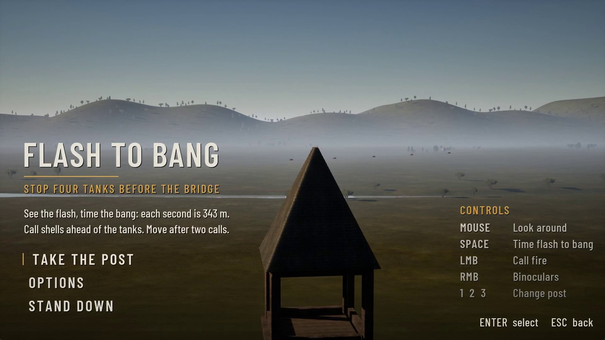
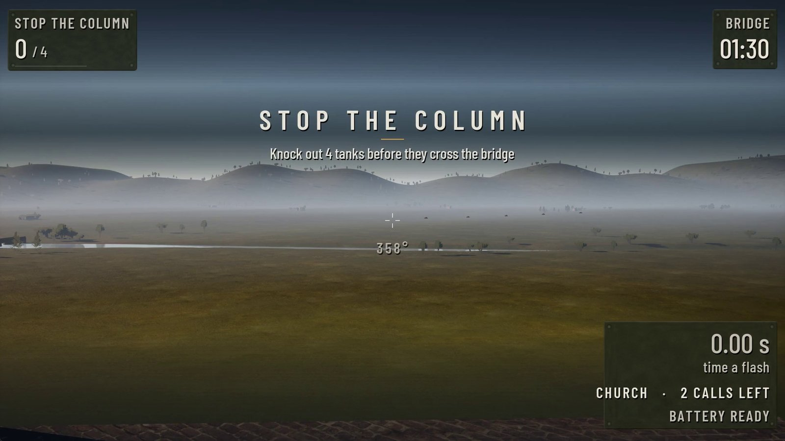
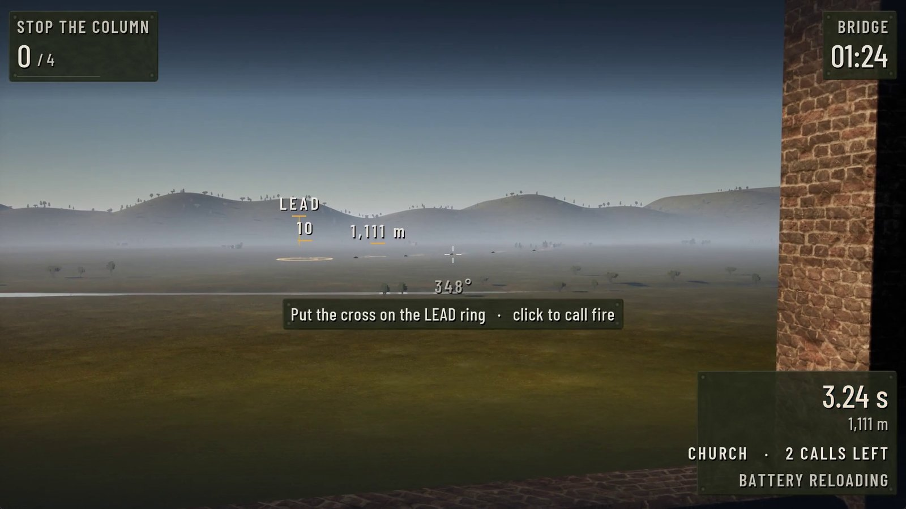
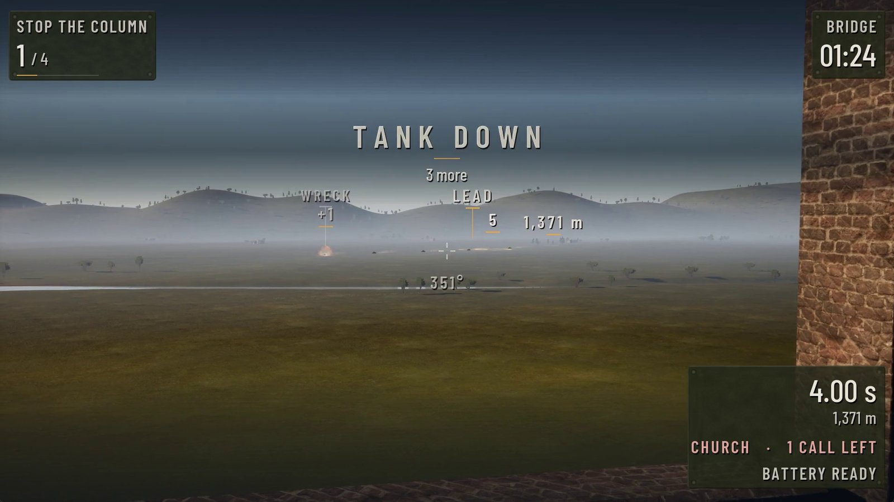

# Flash Count

*Stop four tanks before the bridge.*

A first-person artillery spotting game made in **Unreal Engine 5.8** with gameplay written entirely in C++.

The project still uses its working title, **Flash to Bang** (`FlashtoBang.uproject`), which you'll see on the start screen.

## About

You hunt tanks you can't see. Light arrives instantly and sound takes about three seconds per kilometre, so the gap between a muzzle flash and its boom is your rangefinder. Shells take ten seconds to land, so you have to lead the target. Every call gives your post away, and every burning wreck fills the valley with smoke that hides the next flash.

**Goal:** Knock out four of the five tanks before the column crosses the bridge (about 90 seconds). Lose if a tank reaches the bridge or an enemy shell lands on your post.

**[Watch the full gameplay video (MP4, with sound)](media/gameplay.mp4)**

## Controls

| Key | Action |
|---|---|
| Mouse | Look around |
| Right mouse (hold) | Binoculars |
| Space | Start and stop the flash-to-bang stopwatch |
| Left mouse | Call fire on the marked fix |
| 1 2 3 | Change observation post |

## Highlights

- Range from real sound delay (343 m/s), bearing from your view
- Ten-second shell flight, so every shot is a lead
- Three posts: church tower, haystack and ridge; enemy fire traces repeated calls
- Every model built in code, Poly Haven textures, all sound synthesised at runtime

## Screenshots

| | |
|---|---|
|  Start screen |  Stop the column |
|  Calling fire on the lead tank |  Tank down |

## Play it

1. Install **Unreal Engine 5.8** (Epic Games Launcher) and **Visual Studio 2022** with the *Game development with C++* workload.
2. Download `FlashCount-UE5.8-project.zip` from the [Releases](../../releases) page and unzip it.
3. Double-click `FlashtoBang.uproject` and say **Yes** when it asks to build the modules.
4. Press **Play** in the editor, or right-click the `.uproject` and choose *Launch game*.

This repository holds the source and config. The levels, art and audio (`Content/`) are only in the release zip, because they are too large for git.

## Project layout

| Folder | What's in it |
|---|---|
| `Source/FlashtoBang/` | all gameplay code (C++) |
| `Config/` | engine, input and game settings, including tuning values |
| `media/` | screenshots for this page |

## Credits and licence

Third-party assets (all free to use and redistribute) are listed with their authors and licences in [CREDITS.md](CREDITS.md). The licence and notice files that came with them are in [licenses/](licenses/) and in the release zip.
The code and original content are **all rights reserved**: see [LICENSE](LICENSE).
